# Laboratorio N° 12: Implementación de un sistema de diseño

**Repositorio GitHub:** [https://github.com/josueshadow-24/lab12-sistema-diseno.git](https://github.com/josueshadow-24/lab12-sistema-diseno.git)

**Proyecto Base:** Portal Web - Municipalidad Distrital de El Porvenir
---

## Paso 1: Preparación del archivo y punto de partida

### 1.1 Organización del archivo en Figma
Se creó el archivo `DS-Moso-Lab12` aplicando la convención de nomenclatura estándar en inglés agrupada por barras inclinadas (`/`), debido a la restricción de 3 páginas por archivo del plan Starter de Figma, se estructuraron las secciones requeridas (`Cover`, `Fundamentos`, `Componentes` y `Pantalla de prueba`) consolidando el entorno operativo en un único archivo para garantizar la vinculación directa de variables y componentes.

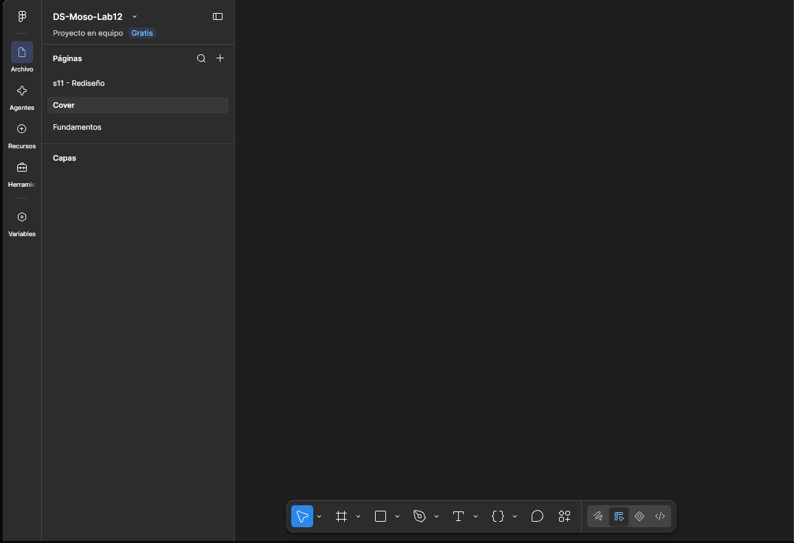

### 1.2 Inventario de Interfaz (UI Audit)
Al auditar la interfaz rediseñada en el Laboratorio 11 (`Municipalidad de El Porvenir — Inicio`), se detectó una alta dispersión visual que justifica la creación del sistema de diseño:
* **Colores:** 14 valores hexadecimales sueltos, múltiples tonos de azul como `#2475CB`, `#0F4C81`, `#2B6CB0`, `#375086`, `#2B70BD`, `#4A50AE` y distintos grises sin estandarizar.
* **Tipografías:** 6 tamaños de texto diferentes sin una escala modular definida.
* **Botones:** 3 estilos distintos de botones con variaciones en bordes, alturas y rellenos.

## Paso 2: Paleta de color con variables (design tokens)

### 2.1 Colección `primitives` y `tokens`
Se implementó una arquitectura de dos niveles en Figma variables:
* **`Primitives` (11 variables):** Escala base de colores (`blue`, `gray`, `red`, `green`) con valores hexadecimales puros.
* **`Tokens` (9 variables semánticas):** Tokens agrupados por propósito (`color/bg/*`, `color/text/*`, `color/border/*`, `color/feedback/*`) vinculados mediante alias hacia los primitivos.

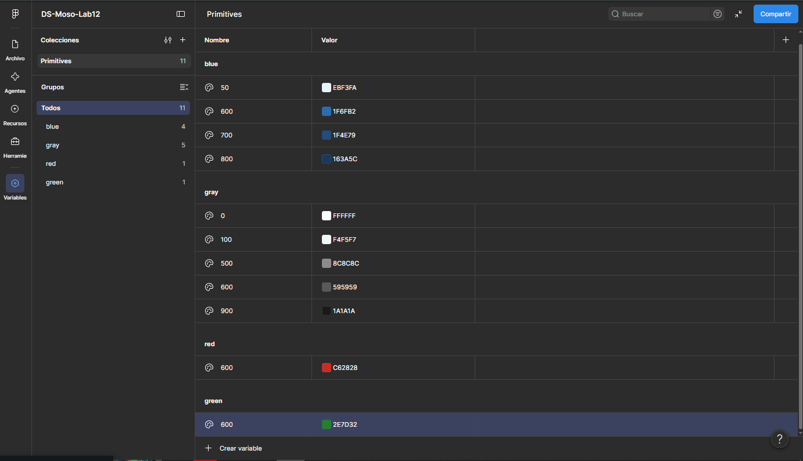
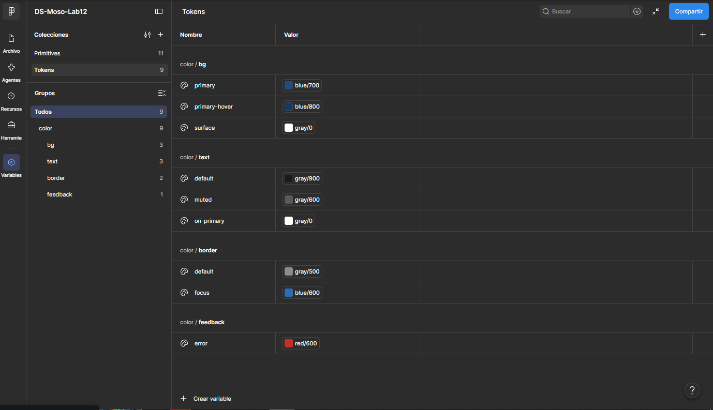

### 2.2 Documentación visual y verificación de contraste (WCAG AA)
Se plasmaron las muestras cromáticas vinculadas a los tokens en la página `Fundamentos` y se validaron los ratios de contraste en WebAIM (superando el mínimo de `4.5:1` exigido):
* `color/text/on-primary` (`#FFFFFF`) sobre `color/bg/primary` (`#1F4E79`): **8.66:1 (Pass AA/AAA)**
* `color/text/default` (`#1A1A1A`) sobre `color/bg/surface` (`#FFFFFF`): **17.40:1 (Pass AA/AAA)**

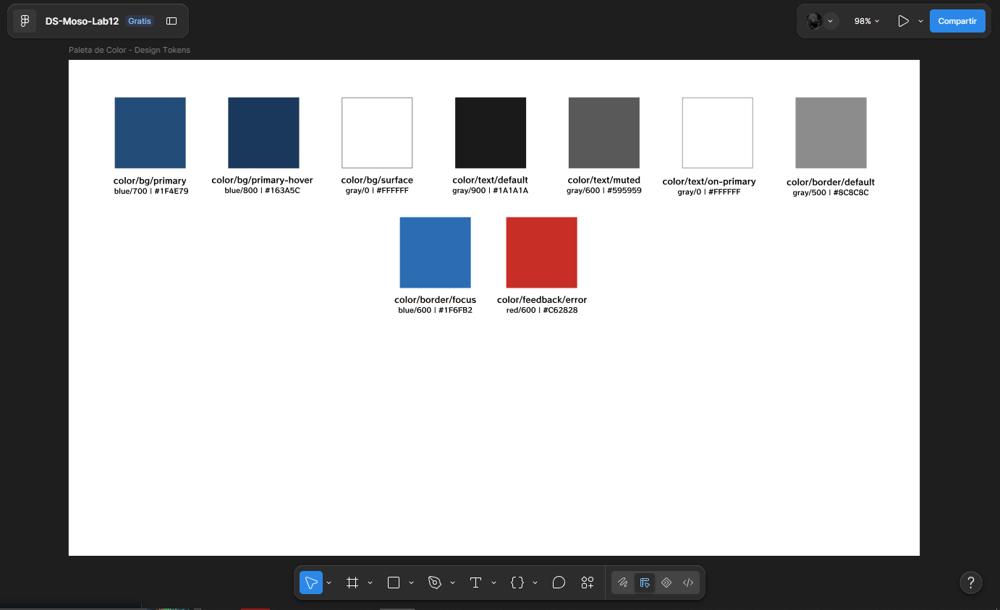

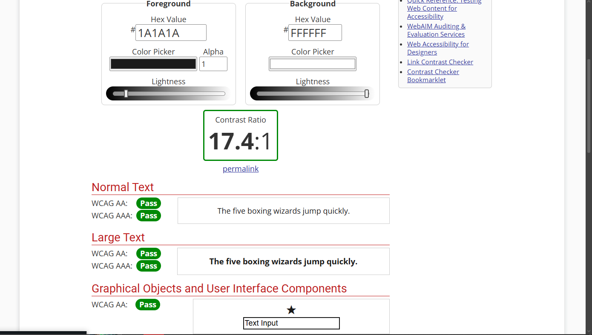

---

## Paso 3: Escala tipográfica y tokens de espaciado

### 3.1 Tokens de espaciado 
Se incorporaron 6 variables numéricas en la colección `Tokens` bajo el grupo `space` (`4`, `8`, `12`, `16`, `24` y `32` píxeles) para estandarizar márgenes, paddings y separaciones entre elementos.

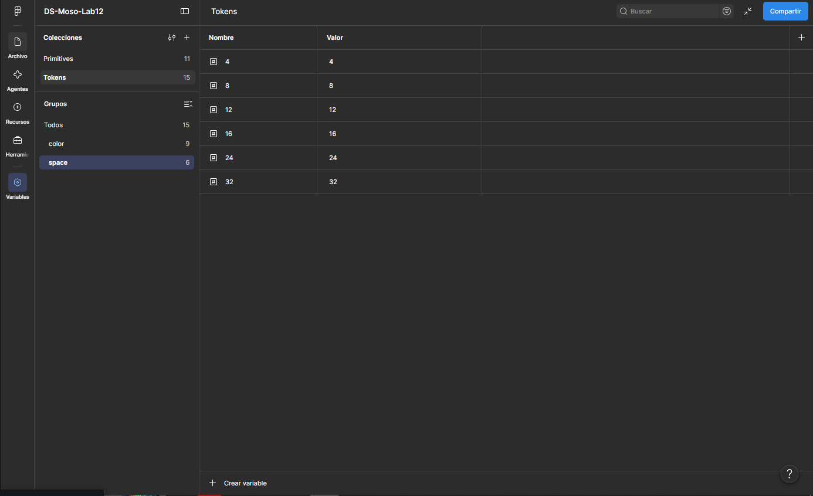

### 3.2 Escala tipográfica 
Se definieron 4 estilos tipográficos utilizando la familia **Inter**, organizados jerárquicamente:
* **`Heading/H1`:** Inter Bold · `32 px` / `40 px`
* **`Heading/H2`:** Inter Semi Bold · `24 px` / `32 px`
* **`Body/Regular`:** Inter Regular · `16 px` / `24 px`
* **`Caption/Small`:** Inter Regular · `12 px` / `16 px`

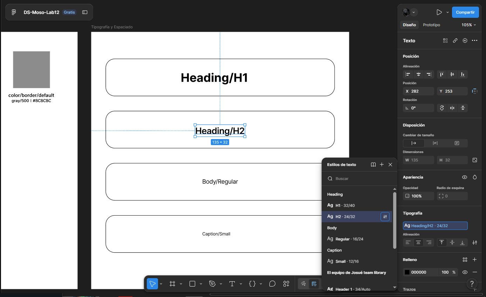
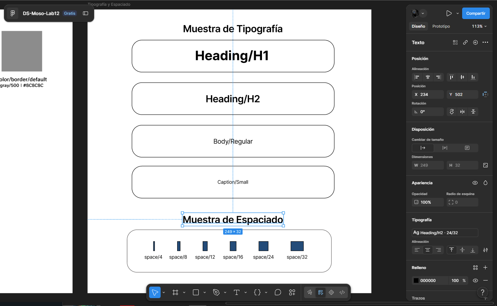

## Paso 4: Componente botón con auto layout y variantes

En la página `Componentes` se desarrollaron los tres componentes reutilizables del sistema utilizando **Auto Layout** y vinculando todas sus propiedades visuales a las variables semánticas (`Tokens`) y estilos tipográficos:

* **`Button`:** Componente con variantes de estado `State` (`Default`, `Hover` y `Disabled`), paddings vinculados a `space/24` y `space/12`, bordes redondeados (`8 px`) y colores `color/bg/primary`, `color/bg/primary-hover` y `color/text/on-primary`.
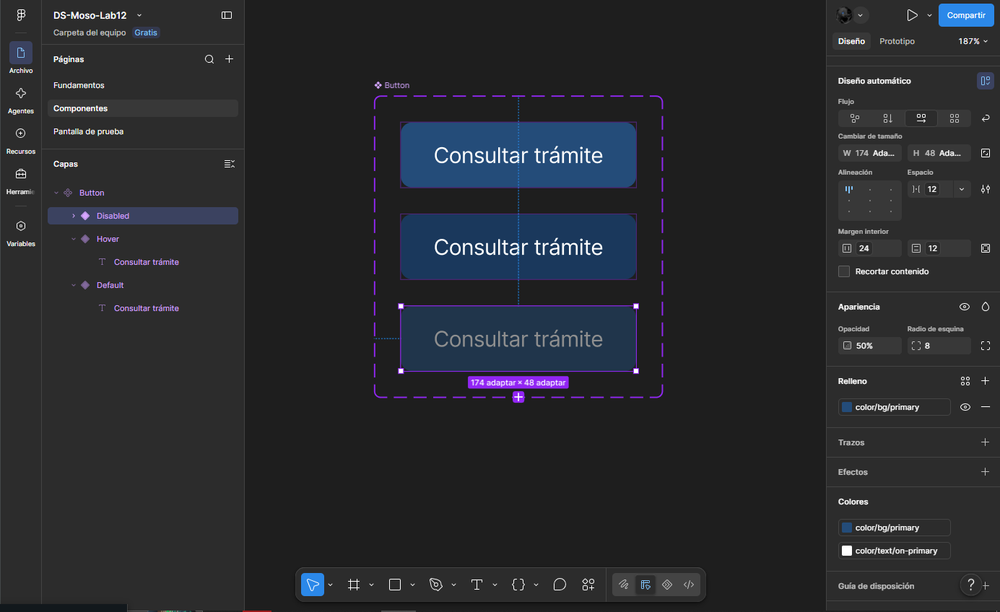
* **`Input`:** Campo de entrada con ancho fijo (`320 px`), paddings `space/16` y `space/12`, superficie `color/bg/surface` y variantes de estado `State` (`Default`, `Focus` y `Error`) vinculadas a los tokens de borde correspondientes.
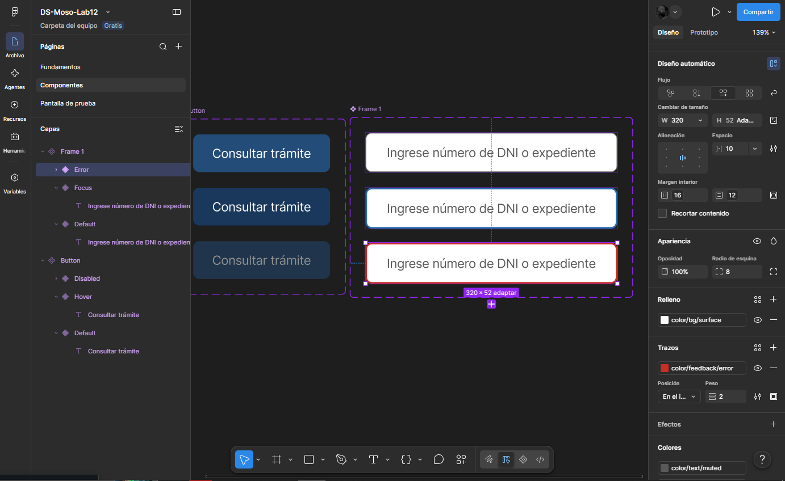
* **`Card`:** Contenedor de servicio municipal (`360 px` de ancho) con estructura vertical (`space/12`), padding `space/24`, radio `12 px` y jerarquía tipográfica (`Heading/H2`, `Body/Regular` y `Caption/Small`).

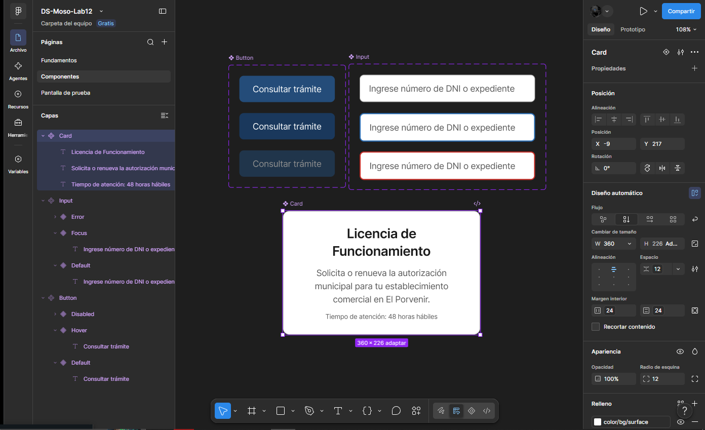