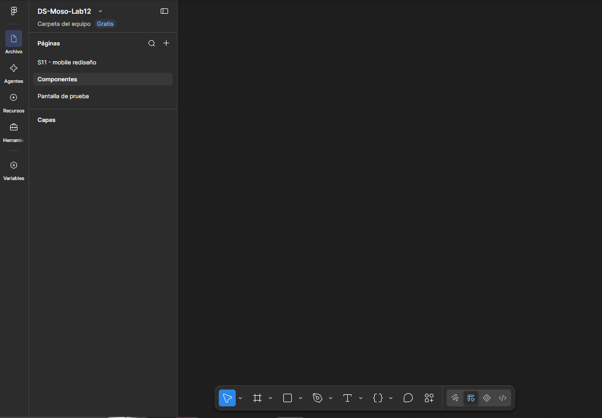

# Laboratorio N° 12: Implementación de un sistema de diseño

**Repositorio GitHub:** [...](...)

**Proyecto Base:** Portal Web - Municipalidad Distrital de El Porvenir
---

## Paso 1: Preparación del archivo y punto de partida

### 1.1 Organización del archivo en Figma
Se creó el archivo `DS-Moso-Lab12` aplicando la convención de nomenclatura estándar en inglés agrupada por barras inclinadas (`/`), debido a la restricción de 3 páginas por archivo del plan Starter de Figma, se estructuraron las secciones requeridas (`Cover`, `Fundamentos`, `Componentes` y `Pantalla de prueba`) consolidando el entorno operativo en un único archivo para garantizar la vinculación directa de variables y componentes.

### 1.2 Inventario de Interfaz (UI Audit)
Al auditar la interfaz rediseñada en el Laboratorio 11 (`Municipalidad de El Porvenir — Inicio`), se detectó una alta dispersión visual que justifica la creación del sistema de diseño:
* **Colores:** 14 valores hexadecimales sueltos, múltiples tonos de azul como `#2475CB`, `#0F4C81`, `#2B6CB0`, `#375086`, `#2B70BD`, `#4A50AE` y distintos grises sin estandarizar.
* **Tipografías:** 6 tamaños de texto diferentes sin una escala modular definida.
* **Botones:** 3 estilos distintos de botones con variaciones en bordes, alturas y rellenos.

