# Laboratorio N° 12: Implementación de un sistema de diseño

**Repositorio GitHub:** [https://github.com/josueshadow-24/lab12-sistema-diseno.git](https://github.com/josueshadow-24/lab12-sistema-diseno.git)

**Proyecto Base:** Portal Web - Municipalidad Distrital de El Porvenir
---

## Paso 1: Preparación del archivo y punto de partida

### 1.1 Organización del archivo en Figma
Se creó el archivo `DS-Moso-Lab12` aplicando la convención de nomenclatura estándar en inglés agrupada por barras inclinadas (`/`), debido a la restricción de 3 páginas por archivo del plan Starter de Figma, se estructuraron las secciones requeridas (`Cover`, `Fundamentos`, `Componentes` y `Pantalla de prueba`) consolidando el entorno operativo en un único archivo para garantizar la vinculación directa de variables y componentes.

### 1.2 Inventario de Interfaz (UI Audit)
Al auditar la interfaz rediseñada en el Laboratorio 11 (`Municipalidad de El Porvenir — Inicio`), se detectó una alta dispersión visual que justifica la creación del sistema de diseño:
* **Colores:** 14 valores hexadecimales sueltos, múltiples tonos de azul como `#2475CB`, `#0F4C81`, `#2B6CB0`, `#375086`, `#2B70BD`, `#4A50AE` y distintos grises sin estandarizar.
* **Tipografías:** 6 tamaños de texto diferentes sin una escala modular definida.
* **Botones:** 3 estilos distintos de botones con variaciones en bordes, alturas y rellenos.

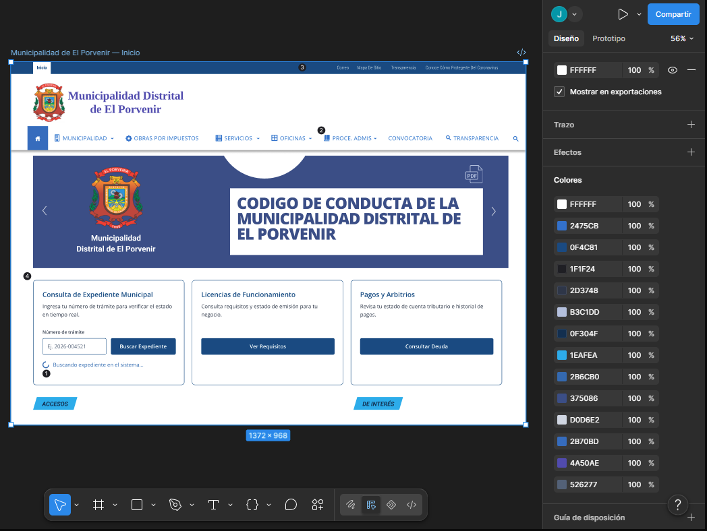

## Paso 2: Paleta de color con variables (design tokens)

### 2.1 Colección `primitives` y `tokens`
Se implementó una arquitectura de dos niveles en Figma variables:
* **`Primitives` (11 variables):** Escala base de colores (`blue`, `gray`, `red`, `green`) con valores hexadecimales puros.
* **`Tokens` (9 variables semánticas):** Tokens agrupados por propósito (`color/bg/*`, `color/text/*`, `color/border/*`, `color/feedback/*`) vinculados mediante alias hacia los primitivos.

### 2.2 Documentación visual y verificación de contraste (WCAG AA)
Se plasmaron las muestras cromáticas vinculadas a los tokens en la página `Fundamentos` y se validaron los ratios de contraste en WebAIM (superando el mínimo de `4.5:1` exigido):
* `color/text/on-primary` (`#FFFFFF`) sobre `color/bg/primary` (`#1F4E79`): **8.66:1 (Pass AA/AAA)**
* `color/text/default` (`#1A1A1A`) sobre `color/bg/surface` (`#FFFFFF`): **17.40:1 (Pass AA/AAA)**

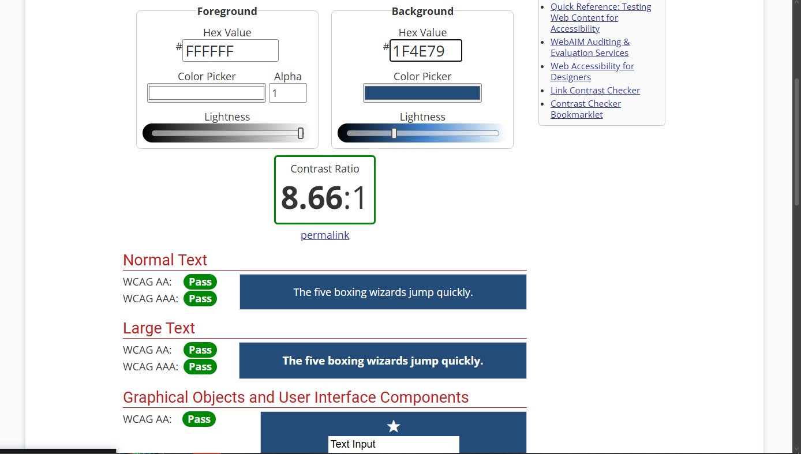

---

## Paso 3: Escala tipográfica y tokens de espaciado

### 3.1 Tokens de espaciado 
Se incorporaron 6 variables numéricas en la colección `Tokens` bajo el grupo `space` (`4`, `8`, `12`, `16`, `24` y `32` píxeles) para estandarizar márgenes, paddings y separaciones entre elementos.

### 3.2 Escala tipográfica 
Se definieron 4 estilos tipográficos utilizando la familia **Inter**, organizados jerárquicamente:
* **`Heading/H1`:** Inter Bold · `32 px` / `40 px`
* **`Heading/H2`:** Inter Semi Bold · `24 px` / `32 px`
* **`Body/Regular`:** Inter Regular · `16 px` / `24 px`
* **`Caption/Small`:** Inter Regular · `12 px` / `16 px`

## Paso 4: Componente botón con auto layout y variantes

En la página `Componentes` se desarrollaron los tres componentes reutilizables del sistema utilizando **Auto Layout** y vinculando todas sus propiedades visuales a las variables semánticas (`Tokens`) y estilos tipográficos:

* **`Button`:** Componente con variantes de estado `State` (`Default`, `Hover` y `Disabled`), paddings vinculados a `space/24` y `space/12`, bordes redondeados (`8 px`) y colores `color/bg/primary`, `color/bg/primary-hover` y `color/text/on-primary`.

* **`Input`:** Campo de entrada con ancho fijo (`320 px`), paddings `space/16` y `space/12`, superficie `color/bg/surface` y variantes de estado `State` (`Default`, `Focus` y `Error`) vinculadas a los tokens de borde correspondientes.

* **`Card`:** Contenedor de servicio municipal (`360 px` de ancho) con estructura vertical (`space/12`), padding `space/24`, radio `12 px` y jerarquía tipográfica (`Heading/H2`, `Body/Regular` y `Caption/Small`).

## Paso 4 extra: Componente `Button` (12 variantes y propiedades)

Se implementó el componente maestro **`Button`** con Auto Layout (`Hug contents`, alto `44 px` ≥ `24×24 px` WCAG 2.5.8), paddings vinculados a `space/12` y `space/24`, gap `space/8` y radio `radius/md`:

* **Propiedades de componente:** `Text` (`Label`), `Boolean` (`Show icon`) e `Instance swap` (`Icon` de `20×20 px`).
* **Matriz de 12 variantes:** `Type` (`Primary`, `Secondary`, `Ghost`) × `State` (`Default`, `Hover`, `Focus` con anillo exterior `2 px` `color/border/focus` WCAG 2.4.7, y `Disabled`).

### Prueba de Auto Layout (antes y después)
| Antes (`"Button"`) | Después (`"Confirmar inscripción al curso"`) |
| :---: | :---: |
| 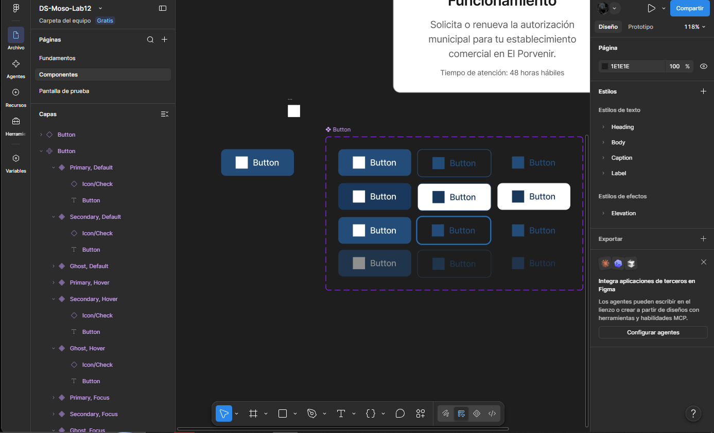 | 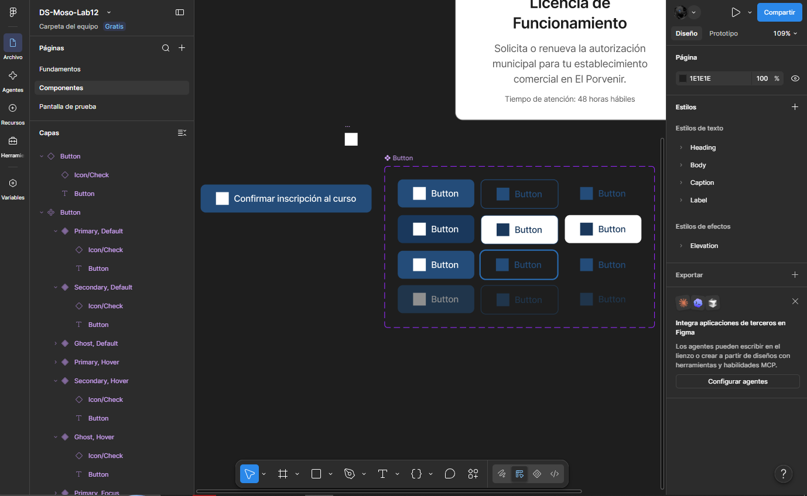 |

## Paso 5: Componente `Input` (5 estados y propiedades)

Se implementó el componente maestro **`Input`** con estructura vertical (`Label`, `Field` de `44 px` de alto y `Helper text`), ancho base `320 px` (`min-width: 200 px`), padding interno `space/12` y `space/16`, gap `space/8` y radio `radius/md`:

* **Propiedades de componente:** 3 `Text` (`Label`, `Placeholder`, `Helper`) y 2 `Boolean` (`Show helper`, `Show icon`).
* **Variantes (`State`):** `Default`, `Focus` (borde `2 px` `color/border/focus`), `Filled` (`color/text/default`), `Error` (borde e ícono `color/feedback/error` + mensaje explícito WCAG 1.4.1) y `Disabled` (`color/bg/subtle` + opacidad `50%`).

### Prueba de Estiramiento (antes y después)
| Antes (`320 px`) | Después (`480 px`) |
| :---: | :---: |
| 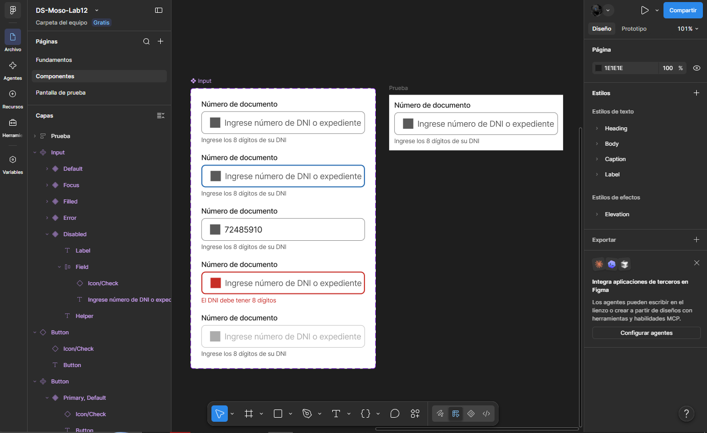 | 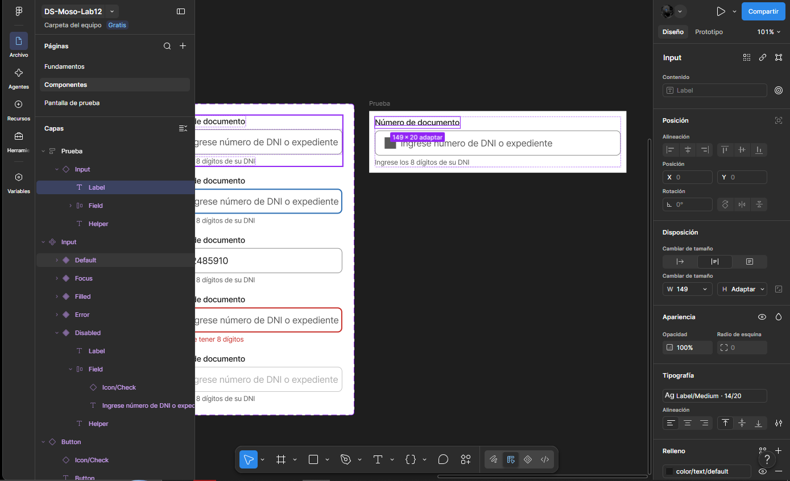 |

## Paso 6: Componente `Card` (tarjeta de trámite municipal)

Se implementó el componente maestro **`Card`** con Auto Layout vertical (`W: 360 px`, `min-width: 280 px`, `H: Hug`), gap `space/12`, padding `space/24`, superficie `color/bg/surface`, radio `radius/lg` y sombra `Elevation/1`:

* **Propiedades de componente:** 3 `Text` (`Title`, `Description`, `Metadata`).
* **Variantes (`State`):** `Default` (borde `1 px` `color/border/default`) y `Hover` (borde `2 px` `color/bg/primary` y elevación reforzada).

### Prueba de responsividad / estiramiento (antes y después)
| Antes (`360 px`) | Después (`520 px`) |
| :---: | :---: |
| 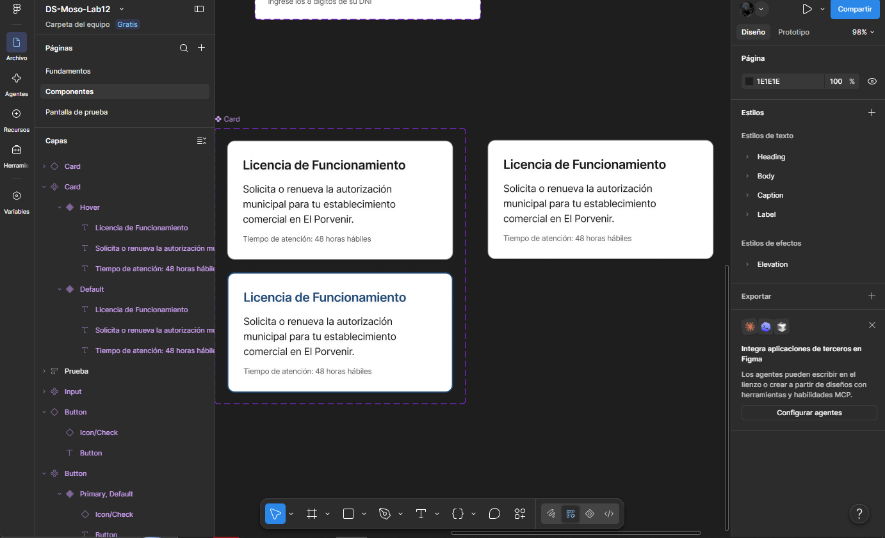 | 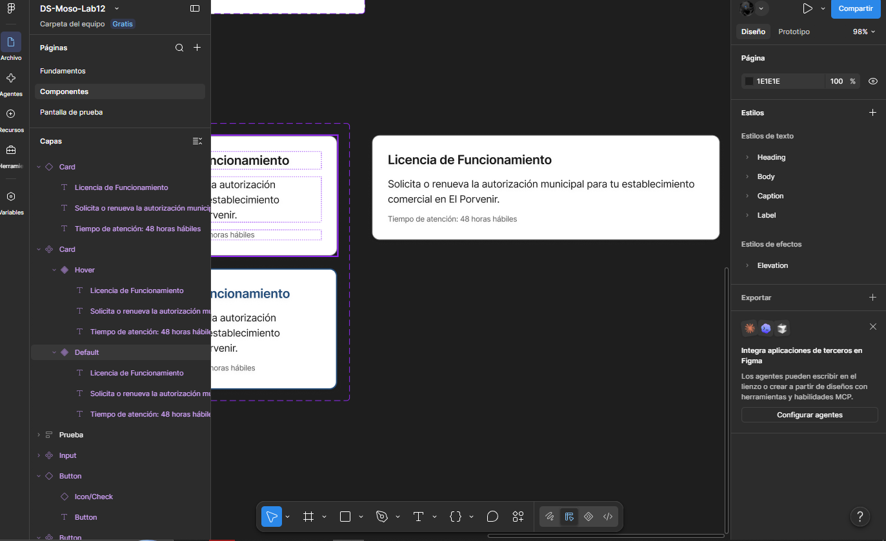 |

## Paso 7: Documentación, prueba del sistema y verificación

### 1. Documentación de componentes y auditoría de tokens
* **Página `Componentes`:** Se documentó cada *component set* (`Button`, `Input` y `Card`) con título, descripción de uso en el lienzo y metadatos en el campo *Description* del panel de propiedades.
* **Auditoría de `Selection colors`:** Al seleccionar el frame `Portal Trámites - El Porvenir` (`1440 × 1024 px`), se verificó que todos los colores pertenecen exclusivamente a variables semánticas (`color/bg/primary`, `color/bg/surface`, `color/text/default`, `color/text/muted`, `color/text/on-primary`, `color/border/default`), sin ningún código hexadecimal suelto.
* **Publicación de librería:** Debido a que el archivo trabaja en plan *Starter* (Gratuito), Figma no habilita la publicación externa de *component sets* como librería compartida entre archivos; la reutilización se verificó dentro del mismo proyecto mediante el panel *Recursos / Assets*.

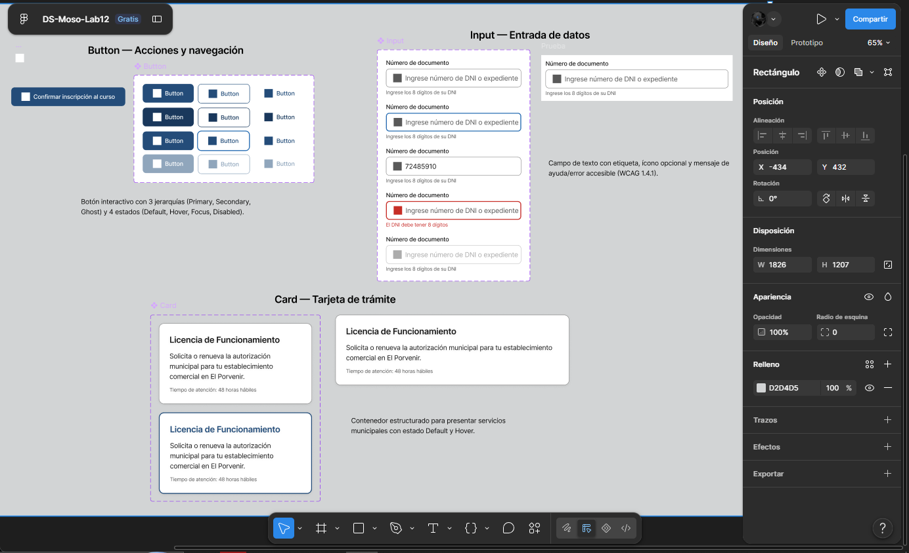
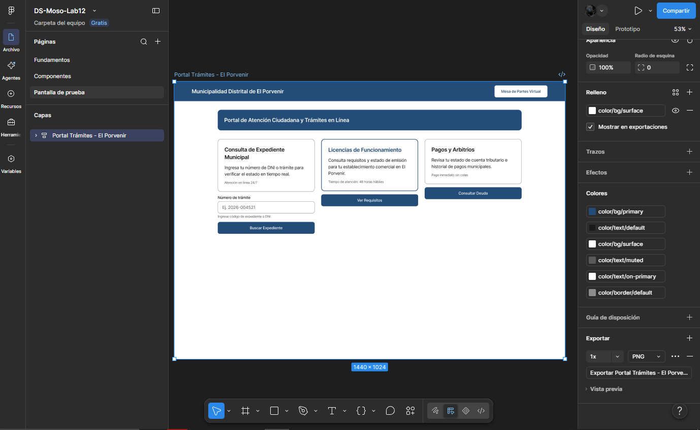

### 2. Prueba de escalabilidad (`blue/700`)
Se modificó temporalmente el valor del primitivo `blue/700` por un tono verde institucional (`#047857`), verificando que toda la pantalla de prueba y los componentes maestros se actualizaron simultáneamente sin ajustes manuales, regresando luego al azul institucional original.

| Antes (`blue/700` original) | Después (cambio temporal de primitivo) |
| :---: | :---: |
| 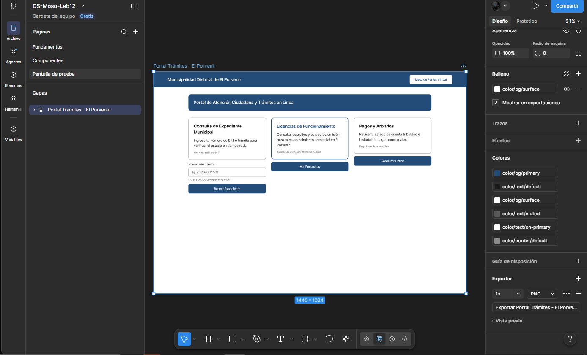 | 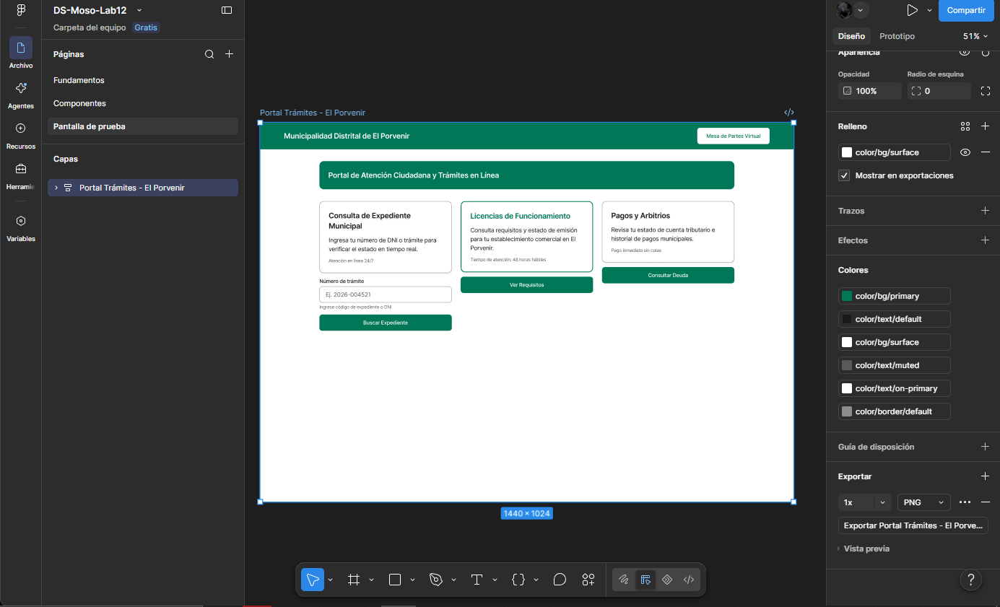 |

### 3. Inventario del sistema de diseño

| N° | Componente | Propiedades (tipo) | N° de variantes | Auto layout (dirección / padding / gap) | Tokens y estilos aplicados |
| :--- | :--- | :--- | :---: | :--- | :--- |
| **1** | **Button** | `Type`, `State` (variant); `Label` (text); `Show icon` (boolean); `Icon` (instance swap) | 12 | Horizontal / `12 · 24` / `8` | `color/bg/primary`, `color/text/on-primary`, `color/border/focus`, `radius/md`, `Label/Medium` |
| **2** | **Input** | `State` (variant); `Label`, `Placeholder`, `Helper` (text); `Show helper`, `Show icon` (boolean) | 5 | Vertical (contenedor) / `0` / `8`; Horizontal (`Field`) / `12 · 16` / `8` | `color/bg/surface`, `color/bg/subtle`, `color/text/default`, `color/text/muted`, `color/border/default`, `color/border/focus`, `color/feedback/error`, `radius/md`, `Body/Regular`, `Label/Medium`, `Caption/Small` |
| **3** | **Card** | `State` (variant); `Title`, `Description`, `Metadata` (text) | 2 | Vertical / `24 · 24` / `12` | `color/bg/surface`, `color/border/default`, `color/bg/primary`, `color/text/default`, `color/text/muted`, `radius/lg`, `Elevation/1`, `Heading/H3`, `Body/Regular`, `Caption/Small` |

### 4. Lista de verificación del sistema

| Criterio | Cumple (Sí / No) | Evidencia (captura) |
| :--- | :---: | :--- |
| Todos los colores de los componentes usan tokens semánticos (sin hexadecimales sueltos). | **Sí** | |
| Todos los textos usan un text style de la escala tipográfica. | **Sí** |  |
| Padding, gap y radios están vinculados a variables de espaciado y radio. | **Sí** |   |
| Button tiene 12 variantes y un alto de objetivo ≥ 24 × 24 px. | **Sí** | `assets/paso4-button-variantes.png` 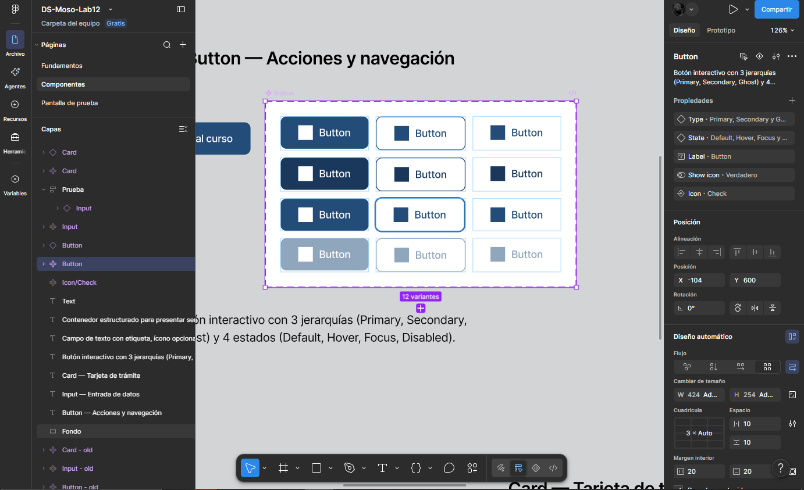 |
| Los estados Focus y Error son visibles y cumplen 3:1 de contraste no textual. | **Sí** |  |
| El texto cumple 4.5:1 de contraste en todas las variantes habilitadas. | **Sí** |    |
| Al cambiar un primitivo o el componente maestro, la pantalla de prueba se actualiza sin ajustes manuales. | **Sí** |  |
| La pantalla de prueba está construida solo con instancias del sistema. | **Sí** | 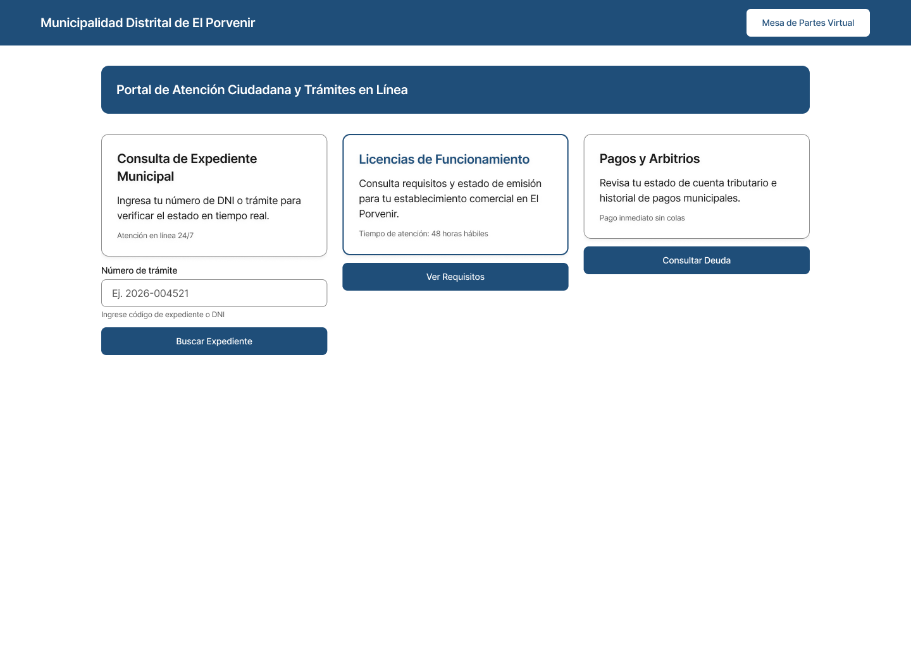 |